# Flipbook editor: a guide for animators

You draw the keyframes; the editor makes the in-betweens; a robot arm paints
every frame, one sheet of paper per frame, with a marker. The editor works like
Adobe Animate (tools on the left, Properties on the right, timeline at the
bottom, Animate's shortcuts), with a few After Effects ideas added: motion
paths and draw on / draw off.

One thing is different from Animate or ToonSquid: **every line you draw becomes
a robot brush stroke straight away.** What you see on the stage is what the
robot will paint, so a few drawing limits apply. They are on the last page,
[What the robot can't do](#what-the-robot-cant-do).

**Starting it.** Rachel usually starts it for you. If you start it yourself:
open a terminal in the `src` folder of the project, run
`python -m inbetween.app`, wait about 20 seconds, and open
<http://localhost:8765> in Chrome.

**Saving.** There is no autosave. **Ctrl+S** downloads your keyframe file
(a `.json`); **Ctrl+O** opens it again. Save often.

Contents

1. [Draw keyframes](#1-draw-keyframes)
2. [Trace with onion skin](#2-trace-with-onion-skin)
3. [The reference layer](#3-the-reference-layer)
4. [Create in-betweens](#4-create-in-betweens)
5. [Pins: fix one in-between](#5-pins-fix-one-in-between)
6. [Motion paths: draw the arc](#6-motion-paths-draw-the-arc)
7. [Draw on / draw off](#7-draw-on--draw-off)
8. [Export for the robot](#8-export-for-the-robot)
9. [Keyboard shortcuts](#keyboard-shortcuts)
10. [What the robot can't do](#what-the-robot-cant-do)

---

## 1. Draw keyframes

Like Animate: draw a key, insert the next key with **F6**, change the drawing.

**Step 1. Draw with the Brush (B).** Pressure sets the line width (with a
mouse, every line is medium width). When you let go, the mark is turned into
a robot stroke. Properties shows the selected stroke: pressure at four points
along it, roundness, position.

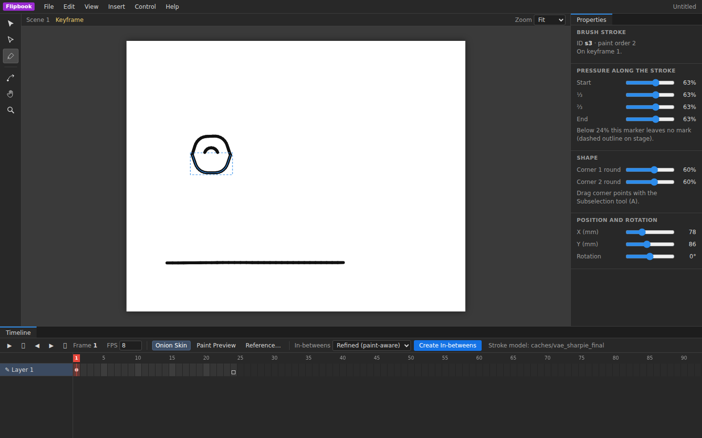

**Step 2. Complex marks are split for you.** One robot stroke can follow only
a fairly simple line (see [What the robot can't do](#what-the-robot-cant-do)).
A zigzag, loop or long scribble is split into several connected strokes, and a
message says how many.

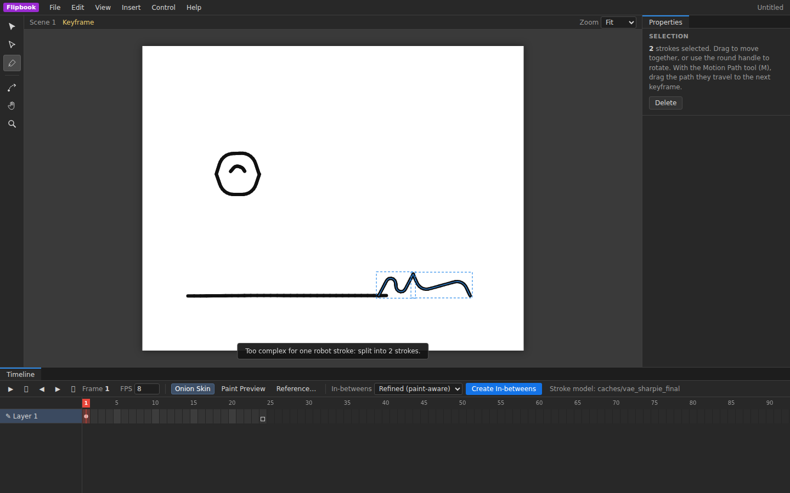

**Step 3. Select with the Selection tool (V).** Click a stroke, or drag a
rectangle around strokes (Shift adds to the selection), as in Animate. **Ctrl+A**
selects everything, **Esc** deselects.

Drag the selection to move it; drag the round handle above it to rotate.

**Step 4. Next keyframe: F6.** Click a frame in the timeline and press **F6**.
It copies the drawing; move or reshape it. The previous key shows as a blue
ghost (onion skin, **O**), the next one as green. Because the strokes were
copied, the editor knows which stroke is which, so it can in-between them.

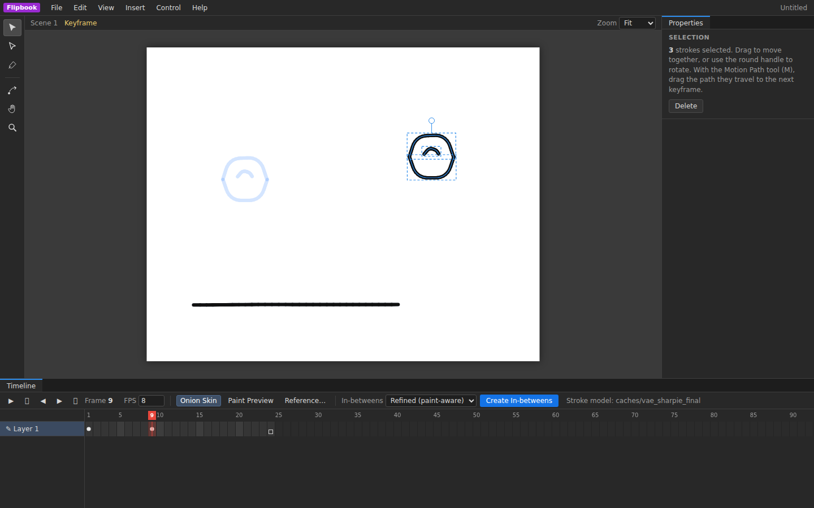

**Step 5. Reshape with the Subselection tool (A).** Every stroke has exactly 4
corner points; drag them to bend the stroke. The pressure and roundness sliders
are in Properties.

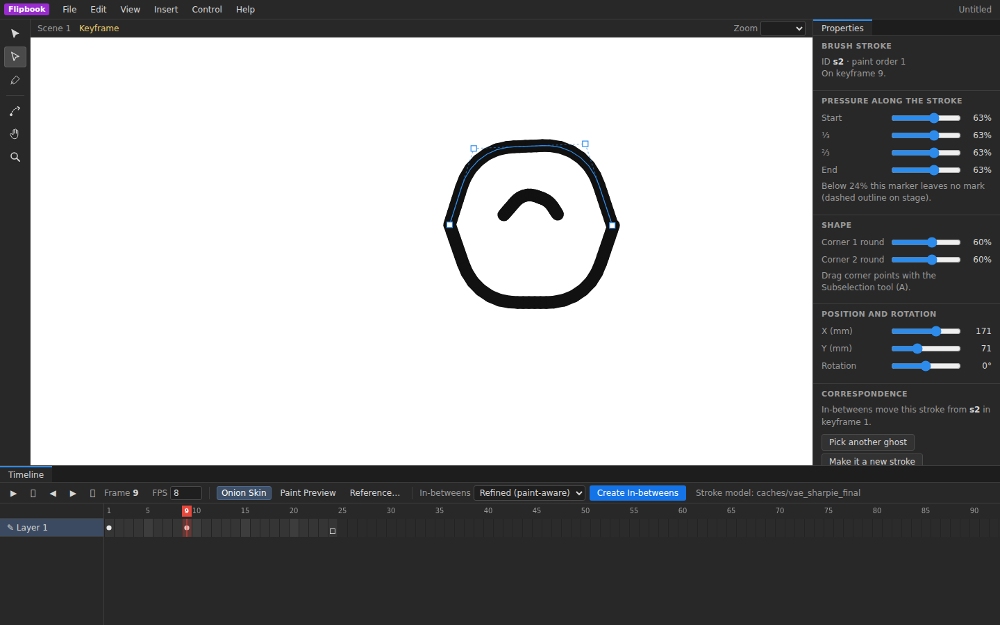

Also as in Animate: **Ctrl+C / Ctrl+X / Ctrl+V** copy, cut, paste (pasted
strokes are new strokes), **Ctrl+D** duplicates, **Ctrl+Shift+V** pastes in
place, **Ctrl+Z** undoes. **Shift+F6** clears a keyframe.

---

## 2. Trace with onion skin

When the drawing changes a lot between keys, it is easier to redraw it than to
reshape it: **F7** inserts a blank keyframe and you trace over the ghosts. The
editor still needs to know which new stroke replaces which old one, so each
traced stroke is linked to a ghost.

**Step 1. F7.** The new key is empty and the previous key shows as blue ghosts.
Properties says how many strokes from the previous key are not traced yet
(untraced strokes disappear halfway between the keys). **Bring back unchanged**
copies them over as they were.

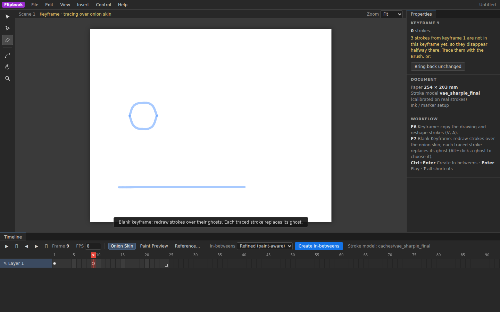

**Step 2. Trace near a ghost.** While you draw, the ghost your mark will
replace turns orange. Let go and the new stroke takes that ghost's place.

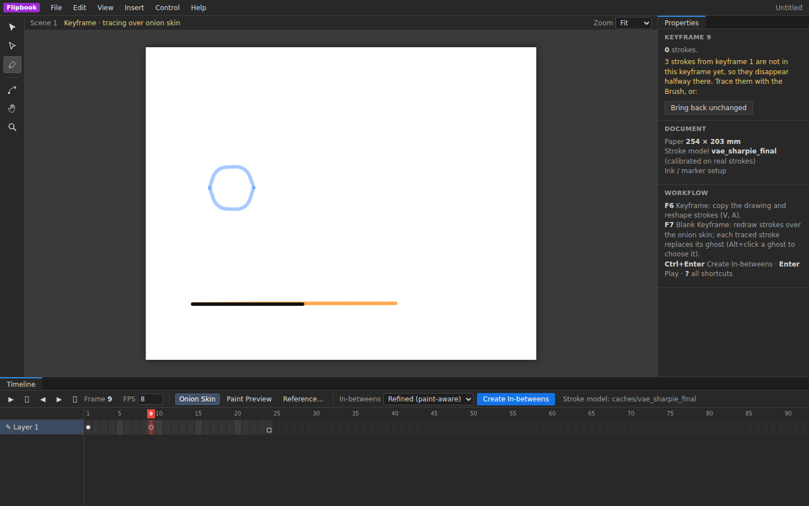

**Step 3. Moved far? Alt+click the ghost first.** If the new drawing is far
from its ghost (the ball jumped), Alt+click the ghost, then draw. The chosen
ghost stays orange until you draw.

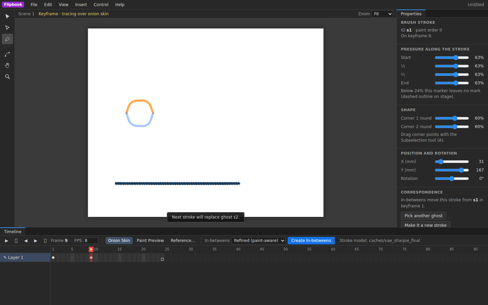

**Step 4. Check the link.** Select a traced stroke: Properties >
Correspondence says which stroke of the previous key it continues. **Pick
another ghost** fixes a wrong link; **Make it a new stroke** unlinks it (it
then appears halfway instead of moving).

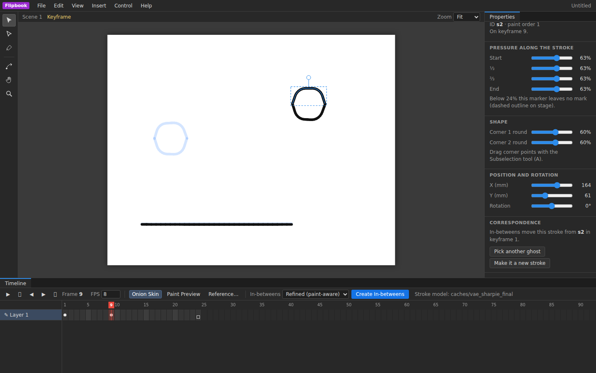

**Step 5. Link many strokes fast: Link mode (L).** With onion skin on, a
keyframe shows in red every stroke that isn't linked to the previous key yet,
and every ghost that has no partner. Properties > Links counts them
("0 of 3 strokes linked"). This is what you'll see on drawings imported from
finished frames, where nothing is linked.

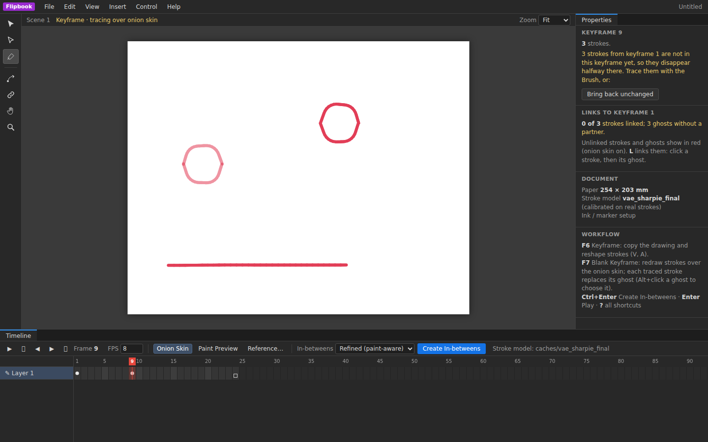

Press **L**, click a stroke, then the ghost it continues; then the next pair,
and so on, without going to Properties. A dashed line joins each linked pair,
and the stroke and its ghost lose the red. If you click a ghost that another
stroke already had, that stroke becomes unlinked (red again). **Ctrl+Z** undoes
the last link; **Esc** leaves Link mode. Strokes you set to Draw on (page 7)
are new on purpose and are not counted.

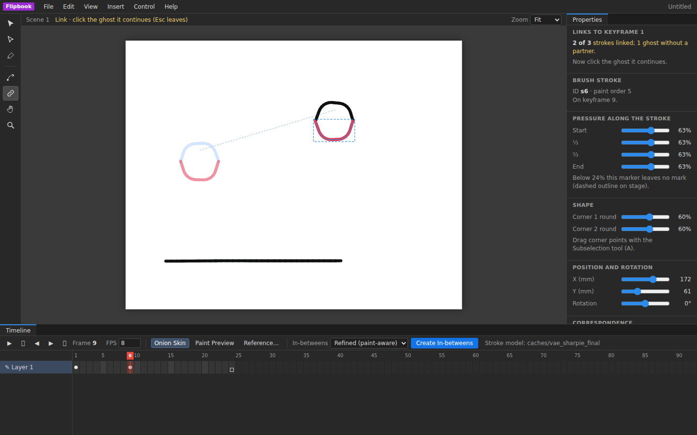

---

## 3. The reference layer

Your own rough animation (a PNG sequence or a video) under the drawing, one
image per frame, to trace over. It is **never** saved, painted or exported.

**Step 1.** Drag the PNGs (all of them, or the folder they're in) or one video
from your file browser and drop them anywhere on the editor. A box shows where
they'll go. You can also click the **Reference layer** box in Properties, or use
**File > Import Reference Frames…**. Frames are put in number order; a video
asks for its frame rate. (Dropping a `.json` keyframe file opens it instead.) The
teal line on the timeline shows which frames have a reference image. **R**
turns it on and off; the slider next to the Reference button sets its opacity.
In Properties (click empty paper) you can change the frame where it starts.

Images are fitted inside the paper, centred. Draw over them as usual.

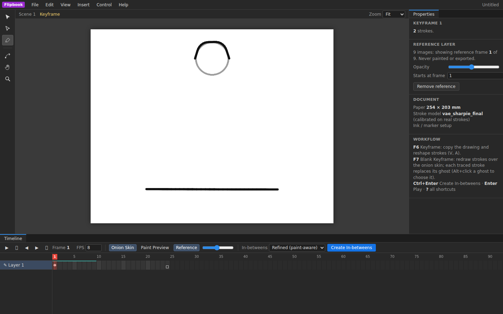

---

## 4. Create in-betweens

**Step 1. Before.** Frames between two keys are empty until you create them
(the timeline shows no purple span; the stage shows the previous key, dimmed).

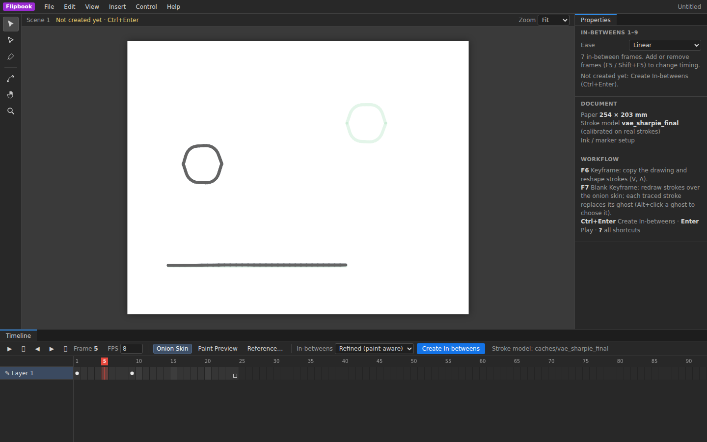

**Step 2. Ctrl+Enter (Create In-betweens).** It takes a few seconds to a
minute. **Refined (paint-aware)** is the default and the one to use: it also
evens out how the marker's line width changes from frame to frame. **Arc** and
**Linear** are faster, for quick checks. The span turns purple and the
in-betweens appear.

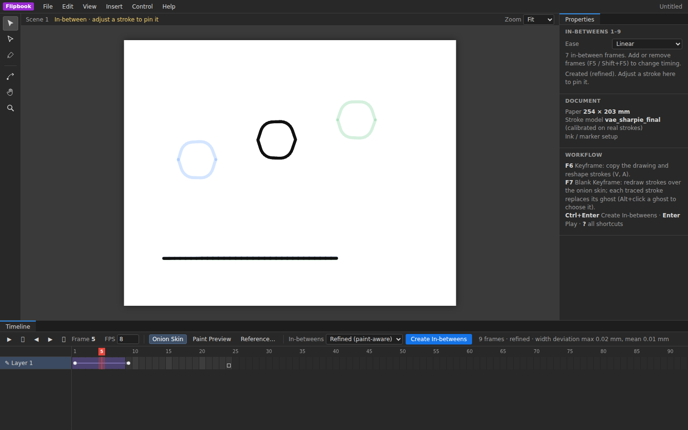

**Step 3. Timing.** Click an in-between: Properties > **Ease** (Linear, Ease In,
Ease Out, Ease In-Out) for that span. **F5** inserts a frame, **Shift+F5**
removes one, as in Animate. **Enter** plays, **, / .** step frames,
**Shift+, / Shift+.** jump between keys; the FPS box sets playback speed.
After any change the span is dashed ("out of date"): press Ctrl+Enter again.

**Step 4. Paint Preview (P).** Shows what the robot's marker is predicted to
paint (soft edges, real line widths), instead of the clean vector view.

---

## 5. Pins: fix one in-between

If one in-between is wrong, fix it directly: select a stroke on that frame and
move, rotate or reshape it. The stroke is **pinned** (orange diamond on the
stage and in the timeline). Create In-betweens again: the pinned stroke stays
exactly as you left it, and the frames around it re-flow to pass through it.
Your fix is never overwritten.

**Delete** on a pinned stroke (or **Unpin** in Properties) removes the pin.

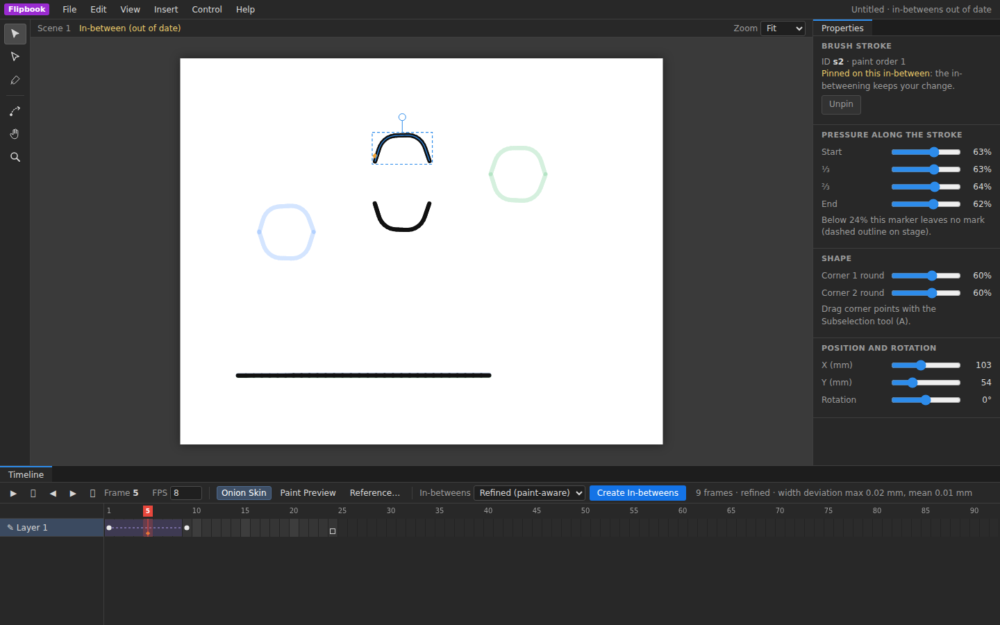

---

## 6. Motion paths: draw the arc

As in After Effects: draw the path a group of strokes travels between two keys,
instead of letting the editor choose it.

**Step 1.** Make both keys (here the ball is on the left at frame 1 and on the
right at frame 11). On the first key, take the **Motion Path tool (M)** and
click the strokes that should travel together (Shift+click adds).

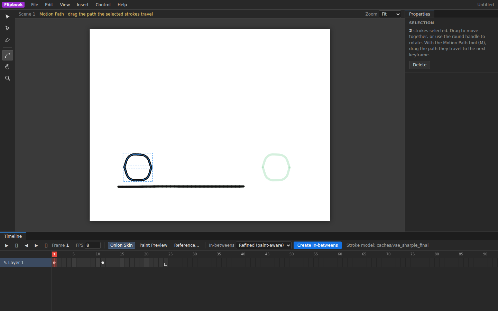

**Step 2.** Drag the path, from the group toward where it lands.

**Step 3.** The ends snap to where the group is on the two keys. The dots are
the group's position on each frame, so you can see the spacing: here the span's
ease is Ease In-Out, so the dots bunch up near the keys. Properties > Motion
Path > **Remove path** deletes it.

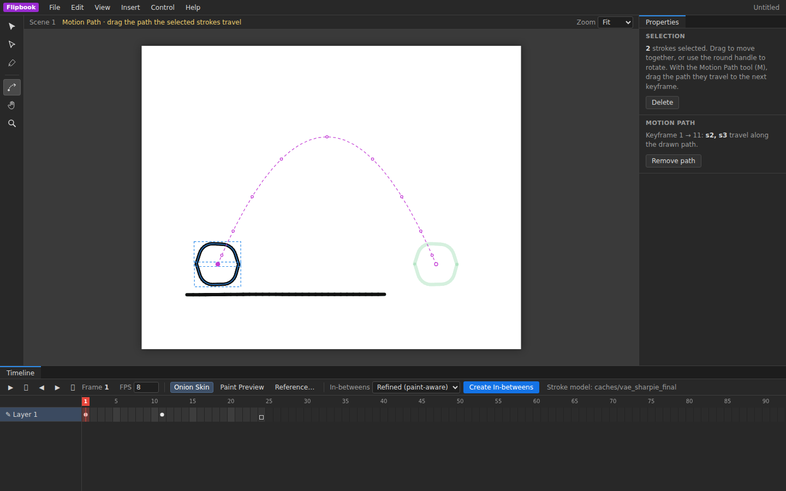

**Step 4.** **Ctrl+Enter.** The group travels along the path; its own rotation
and shape still change from key to key.

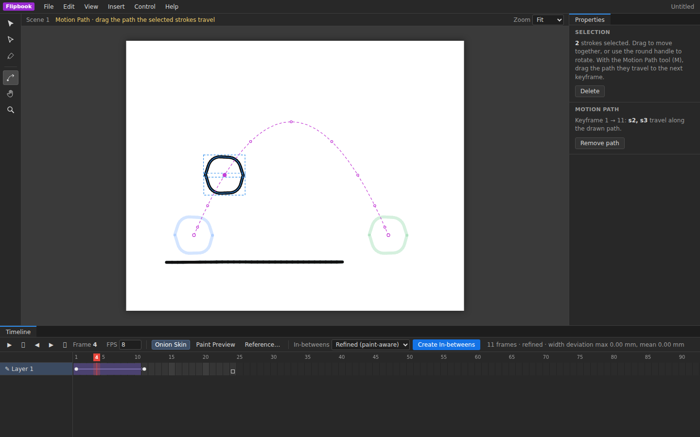

Good to know:
- If you change a key later, the path bends to keep its ends on the group.
- A keyframe inserted inside the span (F6 / F7) splits the path in two; both
  halves keep the span's ease. Clearing a key at either end removes the path.
- A stroke pinned on an in-between keeps its pin and doesn't follow the path.
- A path that leaves the paper gets a warning, and the strokes stop at the
  edge (see [What the robot can't do](#what-the-robot-cant-do)).

---

## 7. Draw on / draw off

A stroke that is new in a keyframe normally pops in halfway between the keys.
With **Draw on** it is drawn progressively over the in-betweens instead, like
After Effects' Trim Paths. **Draw off** is the reverse, for a stroke that is
gone in the next key: it retracts toward where it started.

**Step 1.** On the key where the stroke is new, select it. In Properties >
Appear / Disappear, set **Appears: Draw on**. (On the earlier key, a stroke
missing from the next key has **Disappears: Draw off**.) You can set several
selected strokes at once.

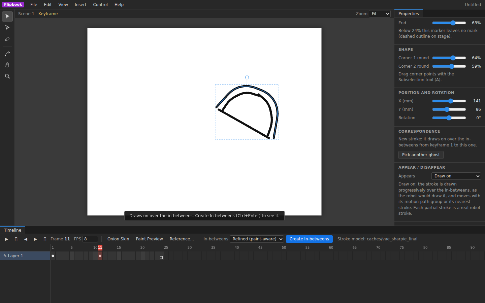

**Step 2.** **Ctrl+Enter.** On each in-between the line is a bit longer,
following the span's ease. It moves with its object: with its motion-path
group if it has one, otherwise with the nearest stroke that is in both keys
(here the arch, which rotates and moves).

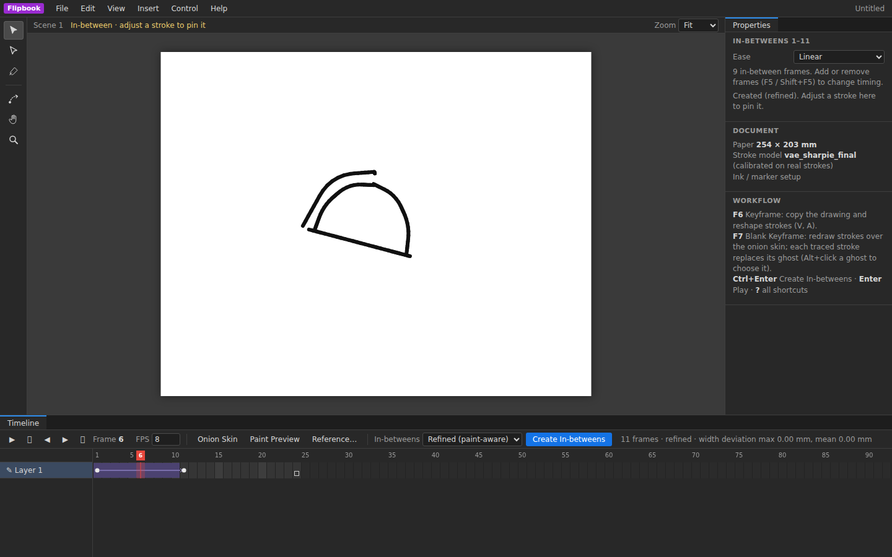

What the robot will paint, frames 1 to 11:

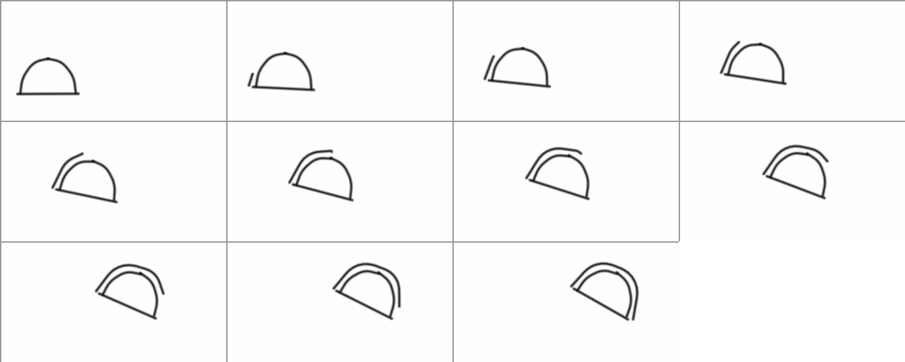

Good to know:
- Every partial line is a real robot stroke, and its end has the full
  stroke's pressure at that point, so a tapered end only appears once the line
  is complete.
- A piece shorter than 2.5 mm is left out (the first frame here).
- It runs over the whole span. To start later, add a keyframe where it should
  start.
- Creating in-betweens takes about a quarter of a second longer per drawing-on
  stroke per frame.

---

## 8. Export for the robot

First make sure the in-betweens are up to date (Ctrl+Enter; the timeline span
is solid purple, not dashed). Then use the **File** menu.

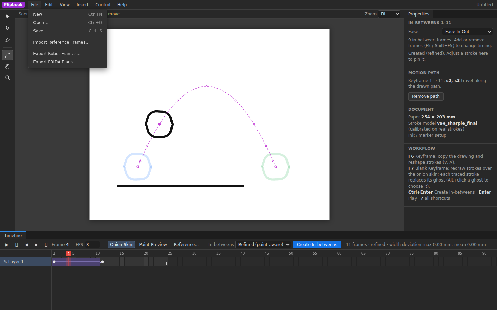

- **Save (Ctrl+S)**: your keyframe file, to open again later. Not for the
  robot.
- **Export Robot Frames…**: one file (`frames_refined.json`) with every frame
  exactly as it will be painted. Rachel runs the robot with it
  (`paint_frames`), one sheet per frame.
- **Export FRIDA Plans…**: a zip with one plan file per frame for FRIDA's own
  tools, a preview picture of each frame, and the frames file again.

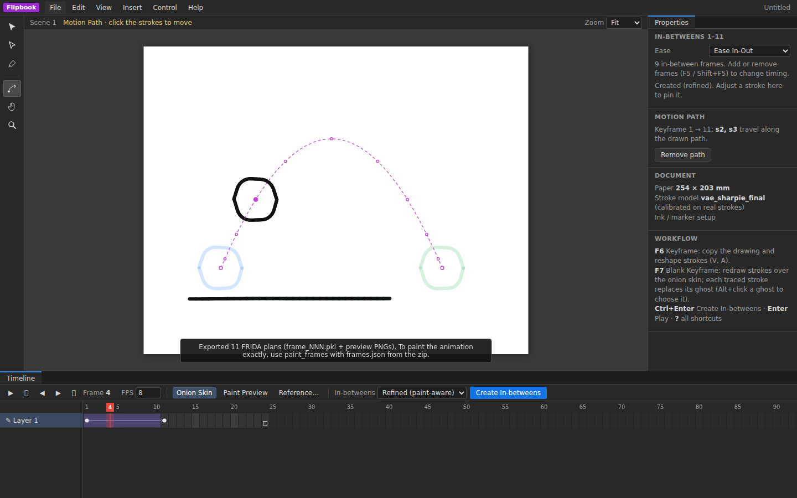

The preview of frame 4 from that zip, as FRIDA's stroke model renders it:

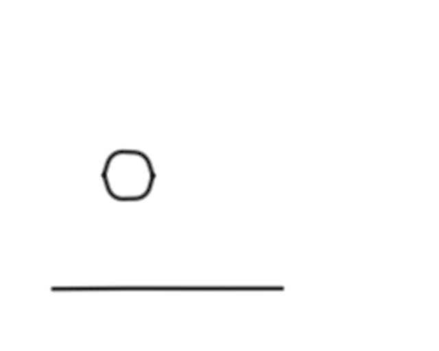

---

## Keyboard shortcuts

Press **?** in the editor for this list.

| Key | Does |
|---|---|
| **V** | Selection tool: click or drag a rectangle to select (Shift adds), drag to move, round handle rotates |
| **A** | Subselection tool: drag a stroke's 4 corner points |
| **B** | Brush tool (pressure sets width) |
| **Alt+click a ghost** | Brush: choose which ghost the next stroke replaces |
| **M** | Motion Path tool: click strokes (Shift adds), then drag the path they travel |
| **L** | Link mode: click a stroke, then the ghost it continues; repeat (Esc leaves) |
| **H** / hold **Space** | Hand tool / pan |
| **Z** | Zoom tool (Alt+click zooms out) |
| **Ctrl+= / Ctrl+- / Ctrl+0** | Zoom in / out / fit |
| **F5 / Shift+F5** | Insert / remove frame (timing) |
| **F6** | Insert keyframe (copies the drawing) |
| **F7** | Insert blank keyframe (trace over onion skin) |
| **Shift+F6** | Clear keyframe |
| **Ctrl+Enter** | Create in-betweens |
| **Enter** | Play / stop |
| **, / .** | Previous / next frame |
| **Shift+, / Shift+.** | Previous / next keyframe |
| **O** | Onion skin on / off |
| **R** | Reference layer on / off |
| **P** | Paint Preview on / off |
| **Del** | Delete selected strokes (on an in-between: unpin) |
| **Esc** | Deselect (in Link mode: leave it) |
| **Ctrl+A** | Select all |
| **Ctrl+C / Ctrl+X / Ctrl+V** | Copy / cut / paste (pasted strokes are new) |
| **Ctrl+Shift+V** | Paste in place (keeps the stroke's identity if this key doesn't have it) |
| **Ctrl+D** | Duplicate |
| **Ctrl+Z / Ctrl+Shift+Z (or Ctrl+Y)** | Undo / redo |
| **Ctrl+S / Ctrl+O / Ctrl+N** | Save / open / new |
| **?** | This list |

---

## What the robot can't do

**4 corners per stroke.** Every robot stroke is a line through 4 corner points
with rounded corners (Subselection shows them, page 1, step 5). That is enough
for an arc, an S-curve or a hook, not for a loop or a zigzag.

**Marks are split automatically.** A mark one stroke can't follow within 1 mm,
anywhere along it and right to its ends, is cut into up to 8 connected
strokes at its sharpest turns (page 1, step 2).
When tracing, each piece links to its nearest ghost. Pressure is kept at only 4
points per piece.

**One stroke reaches at most 15 cm.** A stroke can't reach more than 15 cm
from where it starts, so a longer mark is always split, like this 21 cm line.
Nothing to do on your side: it is still painted as one connected line.

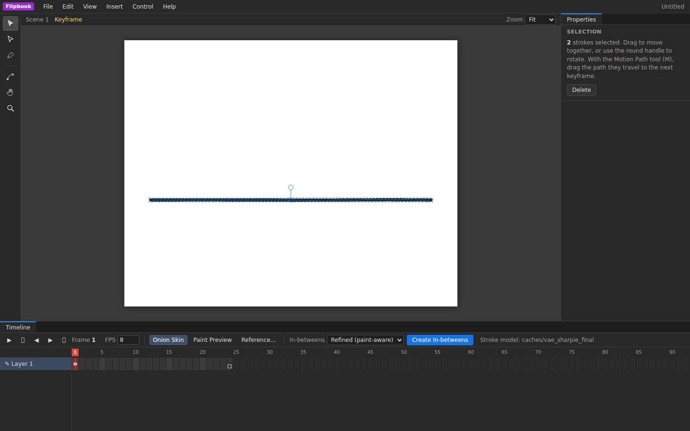

**The lightest visible line.** A marker leaves no mark below a certain
pressure (24% for this one). The lightest stylus touch is mapped to the
lightest line the marker paints clearly (about 0.4 mm), so a light touch never
silently paints nothing. If you lower a stroke's pressure below that in
Properties, it is drawn as a dashed outline (bottom line here): the robot will
not paint it.

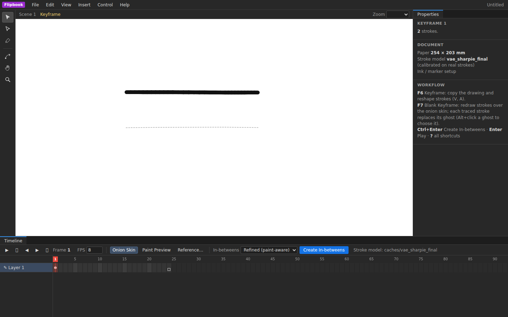

**Nothing past the paper edge.** The robot paints on a 254 × 203 mm sheet.
Keep every stroke fully inside it: a stroke that starts off the paper is moved
onto it when exported (which changes your drawing), and the part of a stroke
that runs past the edge would be painted off the sheet. A motion path that
leaves the paper shows a warning, and the strokes stop at the edge instead of
following it.

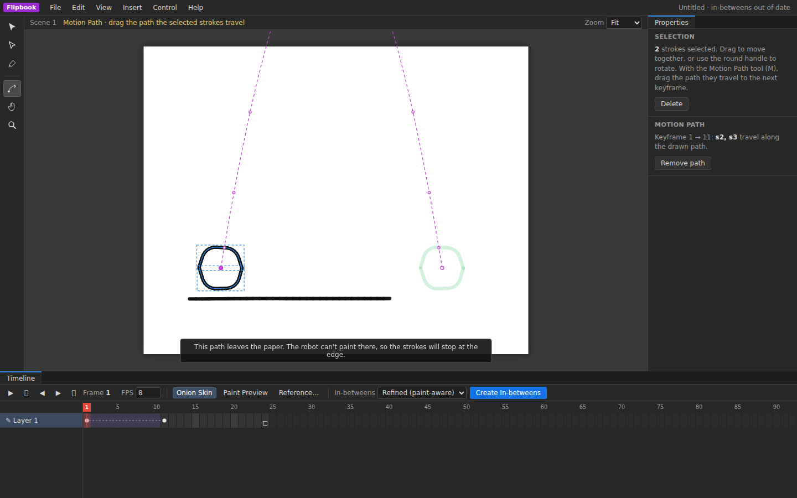

**Lines only.** No fills, washes or color for now: one black marker.
